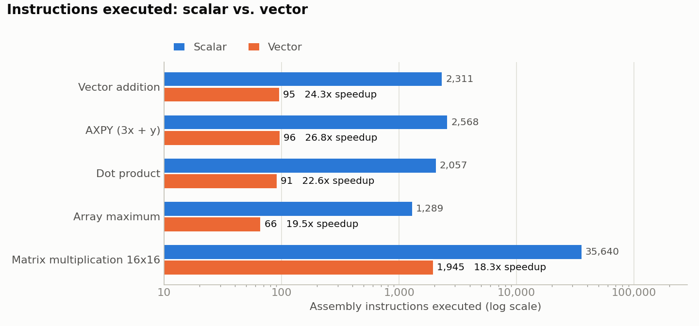

# Scalar vs. vector execution on Kites: metrics and results

## 1. Goal

This report measures how much the RISC-V Vector extension (RVV 1.0) implemented in Kites reduces
the work needed for common data-parallel operations. Each operation is written twice in assembly:

- a **scalar** version using only the base integer ISA with multiply (RV64IM);
- a **vector** version using RVV 1.0.

The two versions are compared by the assembly instructions they execute.

## 2. Benchmarks

| Benchmark | Operation | Size | Vector features used |
|---|---|---|---|
| Vector addition | `c[i] = a[i] + b[i]` | 256 x int32 | unit-stride load/store, `vadd.vv` |
| AXPY | `out[i] = 3 * x[i] + y[i]` | 256 x int32 | multiply-add `vmacc.vx` (vector x scalar) |
| Dot product | `sum(a[i] * b[i])` | 256 x int32 | `vmul.vv`, sum reduction `vredsum.vs`, `vmv.s.x` / `vmv.x.s` |
| Array maximum | `max(a[i])` | 256 x int32 | max reduction `vredmax.vs` |
| Matrix multiplication | `C = A * B` | 16x16 x int32 | `vmacc.vx` on whole rows, `vmv.v.i` |

The programs are in [`programs/`](programs/). Each is `<name>_scalar.s` or `<name>_vector.s`, and each
file starts with:
- the C equivalent of the code;
- a register map;
- the instruction-count derivation;
- the expected result.

Every instruction also has a comment. All ten programs open and run in the Kites GUI as well.

### 2.1 How the programs were written

The aim is a fair comparison of the two instruction sets, not a showcase of hand tuning:

- **Same algorithm, same data:** both versions read identical input arrays, from the `.data` section of each
  file, and write the result to the same place (`out`, address `0x10000000`).
- **Plain loops:** the scalar code is what a compiler emits at `-O2` without unrolling or auto-vectorisation.
  It uses pointer increments, a count-down loop counter and one branch per iteration.
- **Strip-mining:** the vector code is the standard RVV loop. Each pass, `vsetvli` sets `vl = min(remaining
  elements, VLMAX)`, the loop body processes `vl` elements, and the pointers advance by `vl`. This handles any
  array length and any VLEN without changes. (Matrix multiplication sets `vl` once to the row length, 16.)
- **Machine parameters:** VLEN = 128 bits, so with 32-bit elements (SEW = 32) and register groups of 8
  (LMUL = 8), VLMAX = LMUL x VLEN / SEW = 8 x 128 / 32 = **32 elements per instruction**.
  Matrix multiplication uses LMUL = 4, so VLMAX = 16, exactly one row.

### 2.2 Correctness check

Each program is run on the Kites single-cycle VM (`rvss`). `benchmarks/run_benchmarks.py` reads the input arrays
from the program file and computes the expected result in Python. It then compares that result byte for byte
with the memory the program wrote. All ten programs produce exactly the expected output, so the scalar and vector
versions are known to do the same work.

## 3. Metrics

All metrics are **dynamic**: they count instructions as they are executed, so an instruction inside a loop that
runs 256 times counts 256 times. They are collected by `kites-cli --stats`. On the single-cycle VM every step
executes exactly one instruction, and the collector decodes and classifies that instruction after each step (see
`cli/run_stats.h`).

### M1. Dynamic instruction count (IC)

The total number of assembly instructions executed, from the first instruction to the end of the program.
Set-up code (loading addresses, initialising counters) is included.

### M2. Speedup

```
Speedup = IC(scalar) / IC(vector)
```

This is the main comparison metric: how many times fewer instructions the vector version needs for the same
result.

It relates to execution time through the processor performance equation:

```
CPU time = IC x CPI x clock period
```

On the Kites single-cycle VM every instruction, scalar or vector, takes exactly one step (CPI = 1). The speedup
in instruction count is therefore the speedup in simulated execution time. On real hardware a vector
instruction usually needs more cycles than a scalar one, so the time speedup would be lower (see section 6).

### M3. Instructions per element (IPE)

```
IPE = IC / number of elements processed
```

This is the cost of one element of work, independent of the array size. A scalar loop cannot go below one
instruction per element for each operation it performs. A vector loop spreads its instructions over `vl`
elements, so its IPE can be far below 1. For matrix multiplication, an "element" is one entry of C (256 entries).

### M4. Instruction mix

The executed instructions split by class:

| Class | Instructions |
|---|---|
| ALU | integer arithmetic and logic incl. `mul`, `lui`/`auipc`, and the pseudo-instructions that expand to them (`li`, `mv`, `la`) |
| Load/store | scalar `lb`...`ld`, `sb`...`sd` |
| Branch/jump | `beq`...`bgeu` (incl. `bnez`, `blt`), `jal`, `jalr` |
| `vset` | `vsetvli`, `vsetivli`, `vsetvl` |
| Vector load/store | every RVV memory instruction (`vle32.v`, `vse32.v`, ...) |
| Vector compute | every other RVV instruction (arithmetic, reductions, moves) |

The mix shows *where* the savings come from. In a scalar loop most instructions are **loop overhead**, not useful
computation: pointer increments, the counter and the branch.

### M5. Memory instructions and bytes moved

- **Memory instructions:** the number of load and store instructions executed, scalar and vector.
- **Bytes moved:** the total number of bytes those instructions read or wrote.

Equal bytes moved shows that the two versions transfer the same data. Fewer memory instructions means each
instruction moves more data (a `vle32.v` with `vl = 32` loads 128 bytes, where a `lw` loads 4).

### M6. Branches executed

The number of conditional branches executed, which is about the number of loop iterations. Each branch is a
possible pipeline flush on real hardware, so fewer branches means less control overhead.

### M7. Elements per vector instruction (vector utilisation)

```
elements per vector instruction = sum of vl over vector load/store/compute instructions
                                  / number of those instructions
```

This is the average number of elements each vector instruction works on. Its maximum is VLMAX (32 here). A
value close to VLMAX means the vector registers are kept full.

### M8. Analytic instruction-count model

For a loop over N elements the counts follow:

```
IC(scalar) = setup + k_s x N
IC(vector) = setup + k_v x ceil(N / VLMAX)
```

- `k_s` is the scalar loop body length.
- `k_v` is the vector loop body length.

So as N grows, the speedup tends towards `k_s x VLMAX / k_v`. The model predicts the measured counts exactly
(section 4.4).

## 4. Results

Single-cycle VM, VLEN = 128 bits. Raw data: [`results/results.json`](results/results.json) and
[`results/summary.csv`](results/summary.csv). Regenerate with `python benchmarks/run_benchmarks.py`.

### 4.1 Instruction count and speedup (M1-M3)

| Benchmark | IC scalar | IC vector | **Speedup** | IPE scalar | IPE vector |
|---|---:|---:|---:|---:|---:|
| Vector addition | 2,311 | 95 | **24.3x** | 9.03 | 0.37 |
| AXPY | 2,568 | 96 | **26.8x** | 10.03 | 0.38 |
| Dot product | 2,057 | 91 | **22.6x** | 8.04 | 0.36 |
| Array maximum | 1,289 | 66 | **19.5x** | 5.04 | 0.26 |
| Matrix multiplication 16x16 | 35,640 | 1,945 | **18.3x** | 139.22 | 7.60 |

Every benchmark needs **18x to 27x fewer instructions** in its vector version (geometric mean **22.1x**).
The vector loops need only **0.26-0.38 instructions per element**, against 5-10 for the scalar loops.



### 4.2 Instruction mix (M4)

| Benchmark | Version | ALU | Load/store | Branch/jump | vset | Vector load/store | Vector compute | Total |
|---|---|---:|---:|---:|---:|---:|---:|---:|
| Vector addition | scalar | 1,287 | 768 | 256 | - | - | - | 2,311 |
| | vector | 47 | 0 | 8 | 8 | 24 | 8 | 95 |
| AXPY | scalar | 1,544 | 768 | 256 | - | - | - | 2,568 |
| | vector | 48 | 0 | 8 | 8 | 24 | 8 | 96 |
| Dot product | scalar | 1,288 | 513 | 256 | - | - | - | 2,057 |
| | vector | 39 | 1 | 8 | 9 | 16 | 18 | 91 |
| Array maximum | scalar | 522 | 257 | 510 | - | - | - | 1,289 |
| | vector | 30 | 1 | 8 | 9 | 8 | 10 | 66 |
| Matrix multiplication | scalar | 22,824 | 8,448 | 4,368 | - | - | - | 35,640 |
| | vector | 872 | 256 | 272 | 1 | 272 | 272 | 1,945 |

In the scalar vector addition only 256 of the 2,311 instructions (11%) are the actual additions:
- 768 are loads and stores (33%);
- 1,031 are pointer and counter updates and set-up (45%);
- 256 are branches (11%).

The vector version does all 256 additions with **8** `vadd.vv` instructions. Its loop overhead (pointer updates,
`vsetvli`, branch) is paid once per 32 elements instead of once per element.

### 4.3 Memory instructions, branches and utilisation (M5-M7)

| Benchmark | Memory instr. scalar / vector | Reduction | Bytes moved scalar / vector | Branches scalar / vector | Elements per vector instr. |
|---|---:|---:|---:|---:|---:|
| Vector addition | 768 / 24 | 32.0x | 3,072 / 3,072 | 256 / 8 | 32.0 |
| AXPY | 768 / 24 | 32.0x | 3,072 / 3,072 | 256 / 8 | 32.0 |
| Dot product | 513 / 17 | 30.2x | 2,052 / 2,052 | 256 / 8 | 30.2 |
| Array maximum | 257 / 9 | 28.6x | 1,028 / 1,028 | 510 / 8 | 28.6 |
| Matrix multiplication | 8,448 / 528 | 16.0x | 33,792 / 18,432 | 4,368 / 272 | 16.0 |

- **Bytes moved:** identical for the 1-D kernels, so both versions move exactly the same data. The vector
  version just does it with up to 32x fewer instructions. Matrix multiplication moves fewer bytes as well,
  because each `A[i][k]` is loaded once and applied to a whole row of C. The scalar version reloads `A[i][k]`
  for every `j` (4,096 loads of A instead of 256).
- **Branches:** fall from one per element (256) to one per strip (8). In array maximum the scalar version
  also needs a data-dependent branch for every element (510 branches). The vector version replaces it with a
  single `vredmax.vs` per strip.
- **Elements per vector instruction:** for the 1-D kernels this is the full VLMAX of 32, so the vector unit
  is fully used. It is slightly lower for dot product and maximum, because `vmv.s.x` / `vmv.x.s` move one
  element. Matrix multiplication uses 16, its full row length.

### 4.4 Analytic model (M8) and scaling with VLEN

| Benchmark | Scalar model | Vector model | Predicted = measured | Limit `k_s x VLMAX / k_v` |
|---|---|---|---|---:|
| Vector addition | 7 + 9 N | 7 + 11 x ceil(N/32) | 2,311 / 95 | 26.2x |
| AXPY | 8 + 10 N | 8 + 11 x ceil(N/32) | 2,568 / 96 | 29.1x |
| Dot product | 9 + 8 N | 11 + 10 x ceil(N/32) | 2,057 / 91 | 25.6x |
| Array maximum | 3 + 5 N + (max updates) | 10 + 7 x ceil(N/32) | 1,289 / 66 | 22.9x |
| Matrix multiplication | 8 + n(3 + n(8n + 11)) | 9 + n(7n + 9) | 35,640 / 1,945 | grows with n |

For matrix multiplication n = 16. "Max updates" is the number of times a new maximum is found: 6 for this data.

At N = 256 the measured speedups are a little below their limits because the fixed set-up code still counts.
Longer arrays get closer to the limit.

Because the vector loops are strip-mined, **the same vector binary** needs fewer passes on a machine with longer
vector registers. Measured with `kites-cli --vlen`:

| Benchmark | IC scalar | IC vector, VLEN 128 | 256 | 512 | 1024 | Speedup at VLEN 1024 |
|---|---:|---:|---:|---:|---:|---:|
| Vector addition | 2,311 | 95 | 51 | 29 | 18 | 128x |
| AXPY | 2,568 | 96 | 52 | 30 | 19 | 135x |
| Dot product | 2,057 | 91 | 51 | 31 | 21 | 98x |
| Array maximum | 1,289 | 66 | 38 | 24 | 17 | 76x |
| Matrix multiplication | 35,640 | 1,945 | 1,945 | 1,945 | 1,945 | 18.3x |

Matrix multiplication does not scale: a row has only 16 elements. Once VLMAX >= 16, a longer register cannot
hold more of the row.

## 5. Discussion

- **Where the speedup comes from:**
  - **Wider operations:** one vector instruction does the work of up to 32 scalar ones (M7).
  - **Less loop overhead:** pointer arithmetic, counters and branches run once per strip instead of once
    per element (M4, M6). In the scalar loops this overhead is 50-60% of all instructions.
- **Fewer memory instructions:** unit-stride vector loads and stores move a full register group per
  instruction, 32x fewer memory instructions for the same bytes (M5).
- **Reductions:**
  - Dot product and maximum keep their running result in a vector register (`vredsum.vs`, `vredmax.vs`), so
    there is no per-element dependency through a scalar register and no per-element branch.
  - The scalar maximum loop is short (5 instructions per element), so its relative gain (19.5x) is the smallest
    of the 1-D kernels.
- **Matrix multiplication:** the vector version computes a row of C with one `vmacc.vx` per k. The inner loop
  still loads `A[i][k]` with a scalar `lw`, loads row k of B and advances two pointers. So each `vmacc.vx`
  comes with one vector load and 5 scalar instructions, which limits the speedup to about 18x. Vectorising over a longer dimension (larger matrices) or
  unrolling over k would raise it.

## 6. Limitations of the comparison

- **Instruction count is not wall-clock time on real hardware:** a vector instruction with `vl = 32` takes
  more cycles than a scalar add on a real vector unit. How many depends on its datapath width (lanes). The
  speedup here is exact for the Kites single-cycle model (CPI = 1). It is an upper bound on the time speedup of
  an implementation that processes fewer than VLMAX elements per cycle.
- **Memory system not modelled:** caches and memory bandwidth are not part of the measurement. Moving 3 KB
  takes the same simulated time with either instruction set.
- **Hand-written code:** both versions are hand-written in the style of simple compiled loops. A compiler might
  unroll the scalar loop and reduce its overhead somewhat, which would lower the speedups.
- **Fixed sizes and data:** the sizes (256 elements, 16x16) and the random input data are fixed. Only the
  maximum benchmark's scalar count depends on the data (+1 instruction per new maximum).

## 7. Reproducing the results

```bash
# build kites-cli (see the README), then:
python benchmarks/run_benchmarks.py                     # runs all 10 programs, checks results, writes results/
kites-cli benchmarks/programs/dot_vector.s --stats      # one program; prints its instruction mix
kites-cli benchmarks/programs/dot_vector.s --stats --vlen 512
```

`--stats` prints a summary and writes `vm_state/stats_dump.json` with every count used in this report.
