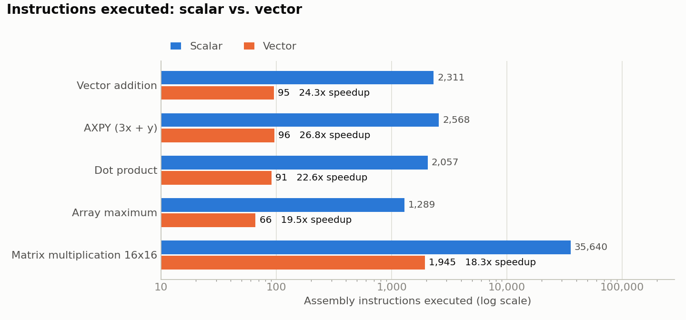

# Benchmark results

Generated by `benchmarks/run_benchmarks.py`; the metrics are defined in [`../REPORT.md`](../REPORT.md). Single-cycle VM, VLEN = 128 bits. Every program produced exactly the expected output.

## Instructions executed and speedup

| Benchmark | Scalar | Vector | Speedup | Scalar instr./element | Vector instr./element |
|---|---:|---:|---:|---:|---:|
| Vector addition | 2,311 | 95 | **24.3x** | 9.03 | 0.37 |
| AXPY (3x + y) | 2,568 | 96 | **26.8x** | 10.03 | 0.38 |
| Dot product | 2,057 | 91 | **22.6x** | 8.04 | 0.36 |
| Array maximum | 1,289 | 66 | **19.5x** | 5.04 | 0.26 |
| Matrix multiplication 16x16 | 35,640 | 1,945 | **18.3x** | 139.22 | 7.60 |

## Instruction mix

| Benchmark | Version | ALU | Load/store | Branch/jump | vset | Vector load/store | Vector compute | Total |
|---|---|---:|---:|---:|---:|---:|---:|---:|
| Vector addition | scalar | 1,287 | 768 | 256 | 0 | 0 | 0 | 2,311 |
|  | vector | 47 | 0 | 8 | 8 | 24 | 8 | 95 |
| AXPY (3x + y) | scalar | 1,544 | 768 | 256 | 0 | 0 | 0 | 2,568 |
|  | vector | 48 | 0 | 8 | 8 | 24 | 8 | 96 |
| Dot product | scalar | 1,288 | 513 | 256 | 0 | 0 | 0 | 2,057 |
|  | vector | 39 | 1 | 8 | 9 | 16 | 18 | 91 |
| Array maximum | scalar | 522 | 257 | 510 | 0 | 0 | 0 | 1,289 |
|  | vector | 30 | 1 | 8 | 9 | 8 | 10 | 66 |
| Matrix multiplication 16x16 | scalar | 22,824 | 8,448 | 4,368 | 0 | 0 | 0 | 35,640 |
|  | vector | 872 | 256 | 272 | 1 | 272 | 272 | 1,945 |

## Memory instructions, branches and vector utilisation

| Benchmark | Memory instr. (scalar / vector) | Reduction | Bytes moved (scalar / vector) | Branches (scalar / vector) | Elements per vector instr. |
|---|---:|---:|---:|---:|---:|
| Vector addition | 768 / 24 | 32.0x | 3,072 / 3,072 | 256 / 8 | 32.0 |
| AXPY (3x + y) | 768 / 24 | 32.0x | 3,072 / 3,072 | 256 / 8 | 32.0 |
| Dot product | 513 / 17 | 30.2x | 2,052 / 2,052 | 256 / 8 | 30.2 |
| Array maximum | 257 / 9 | 28.6x | 1,028 / 1,028 | 510 / 8 | 28.6 |
| Matrix multiplication 16x16 | 8,448 / 528 | 16.0x | 33,792 / 18,432 | 4,368 / 272 | 16.0 |
